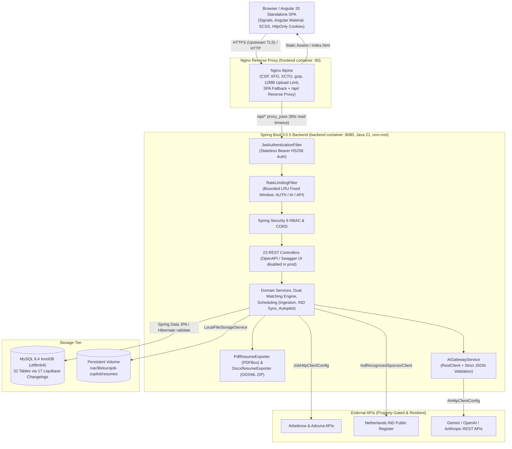

# EuroJob Copilot – System Architecture
**Document Version:** 2.0.0  
**Target Stack:** Angular 20 + Spring Boot 3.5.5 (Java 21 LTS) + MySQL 8.4 + Liquibase + Nginx + Docker Compose

---

## 1. Executive Summary

**EuroJob Copilot** is a full-stack European tech career intelligence, visa sponsorship verification, AI-assisted document tailoring, and application pipeline management platform. The platform pairs an **Angular 20 standalone signal-driven SPA** with a **Spring Boot 3.5.5 modular REST backend** backed by **MySQL 8.4** (32 relational tables managed through 17 Liquibase changelogs) and containerized with multi-stage Docker builds behind an Nginx reverse proxy.

### Key Architectural Principles
1. **Strict Multi-Tenant User Data Isolation:** Every user-owned domain entity (`user_profiles`, `resumes`, `tailored_resumes`, `cover_letters`, `user_job_interactions`, `job_match_scores`, `job_applications`, `recruiters`, `interview_prep_sessions`, `notifications`, `user_saved_companies`, `job_assistant_messages`, `autopilot_run_logs`, `sponsorship_verification_history`) is scoped to the authenticated principal (`user_id`), verified in repository/service ownership checks before read or write operations.
2. **Deterministic + AI Hybrid Intelligence with Anti-Hallucination Guardrails:** Rule-based deterministic job compatibility scoring (`Skills 40%`, `Experience 20%`, `Job Title 15%`, `Location 10%`, `Visa Sponsorship 10%`, `Salary 5%`) executes predictably without external API keys. AI features (JD extraction, semantic matching, master resume parsing, tailored CV generation, cover letters, outreach drafting, contextual job assistant, interview prep coaching) pass through a strict provider abstraction (`AiGatewayService`) backed by Google Gemini, OpenAI, or Anthropic, with strict JSON schema validation and candidate-grounding rules forbidding fabricated roles or skills.
3. **Evidence-Based Visa Sponsorship Rules:** Covers 14 European countries and maintains live synchronization for the Netherlands IND Public Register of Recognized Sponsors. Explicitly enforces the rule that company-level sponsor accreditation **never assumes every individual vacancy offers sponsorship**.
4. **Canonical Multi-Source Job Deduplication:** Discovers roles from legitimate APIs (`ArbeitnowJobProvider`, `AdzunaJobProvider`) and normalizes titles, locations, salaries, arrangements, and SHA-256 `canonical_hash` fingerprints to prevent duplicate job ingestion.
5. **Security-by-Default & Fail-Closed Production Posture:** Short-lived JWT Bearer access tokens (`HS256`), rotated SHA-256 hashed refresh tokens in `HttpOnly; SameSite=Strict` cookies with replay-detection session-family revocation, BCrypt password hashing, bounded-memory per-client `RateLimitingFilter`, strict magic-byte + OOXML zip validation for file uploads, Nginx security headers/CSP/body-size caps, and fail-fast `JWT_SECRET` enforcement in production.

---

## 2. Implemented Feature Modules (23 REST Controllers, 83 API Paths)

| Domain | Backend Package | Frontend Feature Route | Implemented Capabilities |
|---|---|---|---|
| **Health & Observability** | `core/health` | — | `/api/v1/health` probe + Spring Boot Actuator `/actuator/health`, `/actuator/info`, and admin-gated `/actuator/metrics`. |
| **Auth & Security** | `modules/auth`, `config` | `/auth/login`, `/auth/register`, `/auth/forgot-password`* | BCrypt registration/login, 15m JWT access tokens, 7d rotated refresh cookies with replay revocation, `ROLE_USER`/`ROLE_ADMIN` RBAC, `RateLimitingFilter` (`AUTH`, `AI`, `API`). *Note: password reset email flow is a UI placeholder pending SMTP integration.* |
| **Profile & Preferences** | `modules/user` | `/profile`, `/settings` | Candidate career profile, skills CRUD, work experience & education timelines, salary expectations, EU relocation preferences, target countries/roles, autopilot toggles. |
| **Master Resumes** | `modules/resume` | `/resumes`, `/profile` | Multi-version PDF/DOCX upload (`<= 10MB`), PDF `%PDF-` + OOXML ZIP entry verification, Apache PDFBox / XML text extraction, AI structured CV parsing, mandatory user review & master approval sync. |
| **Job Ingestion & Normalization** | `modules/job/ingestion`, `modules/job/normalization` | — (Admin APIs + scheduler) | Scheduled & admin-triggered discovery via Arbeitnow & Adzuna, `AtomicBoolean` single-run concurrency lock, incremental lookback watermarks, SHA-256 `canonical_hash` deduplication, fetch logs (`job_fetch_logs`), stale job deactivation. |
| **Job Discovery & Actions** | `modules/job` | `/jobs` | Faceted search (`JobSearchRepositoryImpl` Criteria API), country/city/arrangement/contract/seniority/sponsor/salary/match filters, Save/Interested/Hide state, validated HTTP(S) apply redirect tracking. |
| **Job Intelligence & Dual Matching** | `modules/matching`, `modules/job/intelligence` | `/jobs` (Inspector Drawer) | Weighted deterministic breakdown + batch recalculation, versioned AI JD structured extraction (`job_ai_analysis_history`), separate AI semantic comparison & skill gap coaching. |
| **Visa Sponsorship & Companies** | `modules/sponsorship`, `modules/company` | `/sponsorship`, `/companies` | 14-country EU sponsorship directory, Netherlands IND Public Register sync & search, company verification & history audit trail, employer dossiers, active openings, priority target bookmarks. |
| **Tailored CVs & Export** | `modules/resume` (`tailored`, `template`, `exporter`) | `/resume-builder` | JD-tailored AI resume generation (anchored in approved master CV + profile), ATS keyword coverage scoring, rich section editor, 4 ATS templates (`MODERN`, `MINIMAL_ATS`, `EUROPASS`, `CLASSIC`), PDFBox (`PdfResumeExporter`) & OOXML (`DocxResumeExporter`) exports. |
| **Cover Letters** | `modules/coverletter` | `/cover-letter` | AI job-specific cover letter builder (`PROFESSIONAL`, `CONFIDENT`, `ACADEMIC` tones), inline editor, grounding metadata, PDF/DOCX/TXT export. |
| **Applications & Recruiter CRM** | `modules/application`, `modules/recruiter` | `/applications` | 10-stage Kanban/Table application pipeline with transition audit history, document linking, recruiter contact book, interaction log, follow-up reminders, AI outreach drafts (`LINKEDIN`/`EMAIL`). |
| **Dashboard & Market Analytics** | `modules/dashboard`, `modules/analytics` | `/dashboard`, `/analytics` | Executive KPI summary, candidate readiness score, funnel stages, recent activity feed, European country comparison, Angular/Java/Full-Stack role breakdown, discovery trend series, source coverage. |
| **AI Application Assistant** | `modules/assistant` | `/jobs` (Assistant Tab) | Persisted contextual job assistant conversations (`job_assistant_messages`) with quick actions, custom prompts, and editable saved drafts. |
| **Autopilot & Notifications** | `modules/autopilot`, `modules/notification` | `/recommended-jobs`, `/notifications` | Scheduled & manual cooldown-guarded autopilot scans, ranked job feed, follow-up alert generation, deduplicated in-app notification center, and property-gated digest notifier (`LoggingAutopilotEmailNotifier` logging stub). |
| **AI Interview Preparation** | `modules/interview` | `/interview-prep` | Job-tailored session generation (Technical, System Design, Behavioral), company prep topics, practice answer grading (`0..100`) with strengths/missing-elements coaching, performance trend analytics. |

---

## 3. High-Level System Architecture

---

## 4. Security & Request Pipeline Architecture

### 4.1 Spring Security Filter Chain Order
1. **CORS Filter:** Enforces `app.cors.allowed-origins` (`CORS_ALLOWED_ORIGINS`), allows credentials (`true`) for cookie refresh flows, and exposes `Content-Disposition`, `Set-Cookie`, `Retry-After`, `X-RateLimit-*`.
2. **`JwtAuthenticationFilter`:** Validates Bearer HS256 access token signatures, `issuer`, expiration, and user `ACTIVE` status against the database; clears context cleanly on malformed/expired tokens.
3. **`RateLimitingFilter`:** Runs immediately after `JwtAuthenticationFilter` so authenticated callers are isolated by `user:<id>` and anonymous auth callers by `ip:<remoteAddr>`:
   - `AUTH` bucket (`POST /api/v1/auth/login`, `/register`, `/refresh`): default `20 req / 60s`.
   - `AI` bucket (`POST` AI parse, tailored CV/CL generate, JD analysis, AI match, assistant respond, outreach generate, interview prep generate/answer, autopilot run): default `30 req / 60s`.
   - `API` bucket (all other `/api/v1/**` calls except `/api/v1/health` and `OPTIONS`): default `180 req / 60s`.
   - Bounded LRU cache (`maxTrackedClients = 10000`) prevents memory exhaustion attacks.
   - Disabled in `test` profile (`app.rate-limit.enabled=false`) and verified by dedicated unit & integration tests.
4. **URL & Method Authorization (`@EnableMethodSecurity`):**
   - Public routes: `/api/v1/health`, `/api/v1/auth/register|login|refresh`, `/actuator/health/**`, `/actuator/info`, and (outside `prod`) OpenAPI/Swagger routes.
   - Admin routes (`/api/v1/admin/**`, `/actuator/**`): require `ROLE_ADMIN` plus class-level `@PreAuthorize("hasRole('ADMIN')")`.
   - All other endpoints require authenticated principal.

### 4.2 Current Scope & Pending Integrations
- **Production Modules:** Auth/JWT + Refresh Token Rotation, Profile/Skills/Education/Experience/Preferences, Master Resume Upload/Extraction/AI Parsing/Approval, Arbeitnow & Adzuna Ingestion + Deduplication, Faceted Search & Interactions, Deterministic + AI Matching, 14-Country Sponsorship + IND Live Sync + Audit History, Employer Dossiers + Saved Companies, Tailored CV & Cover Letter AI Generation + Editor + PDF/DOCX Export, 10-Stage Kanban Pipeline + Recruiter CRM + AI Outreach, Dashboard + Market Analytics, Contextual Job Assistant, Scheduled & Manual Autopilot, In-App Notifications, and AI Interview Prep + Performance History.
- **Pending SMTP Infrastructure:**
  - **Email Notifications:** `AutopilotEmailNotifier` is implemented by `LoggingAutopilotEmailNotifier`, which logs digest eligibility when `app.notifications.email.enabled=true` and user opt-in is enabled; no SMTP relay (`spring-boot-starter-mail`) is configured yet.
  - **Self-Service Password Reset:** `password_reset_tokens` schema and `/auth/forgot-password`, `/auth/reset-password` frontend routes exist, while backend password-reset token issuance/reset endpoints are deferred until an outbound transactional email provider is configured.
