# EuroJob Copilot – Database Design & Liquibase Migration Specification
**Document Version:** 2.0.0  
**Engine:** MySQL 8.4 (InnoDB, `utf8mb4` / `utf8mb4_unicode_ci`)  
**Migration Manager:** Liquibase (`classpath:db/changelog/db.changelog-master.xml`)

---

## 1. Database Overview

The EuroJob Copilot persistence schema consists of **32 relational tables** managed across **17 Liquibase changelogs** (`42` changesets total). Hibernate runs with `spring.jpa.hibernate.ddl-auto=validate` in `local`, `dev`, and `prod` profiles to ensure JPA entity mappings never drift from the Liquibase schema.

### Design Standards
- **Primary Keys:** `BIGINT UNSIGNED AUTO_INCREMENT` (`id`) on all tables; public-facing API resources (`users`, `resumes`, `tailored_resumes`, `cover_letters`, `job_applications`, `job_assistant_messages`, `jobs`) additionally expose `CHAR(36)`/`VARCHAR(36)` `uuid` identifiers where appropriate.
- **Timestamps:** Stored in UTC (`serverTimezone=UTC`) via `DATETIME` / `Instant` columns (`created_at`, `updated_at` audited via Spring Data JPA `JpaAuditingConfig`).
- **Semi-Structured Data:** MySQL `JSON` columns store normalized arrays/ASTs (e.g., `parsed_content_json`, `resume_data_json`, `required_skills`, `preferred_countries`, `highlights_json`) paired with normalized relational columns and indexes for query/filter fields.
- **Concurrency Control:** Mutable aggregate roots (`user_profiles`, `user_job_preferences`, `resumes`, `tailored_resumes`, `cover_letters`, `job_applications`, `jobs`, `companies`) carry a JPA `@Version` integer lock column.

---

## 2. Entity Relationship Diagram (32 Tables)

```mermaid
erDiagram
    USERS ||--o{ REFRESH_TOKENS : "owns"
    USERS ||--o{ PASSWORD_RESET_TOKENS : "owns"
    USERS ||--|| USER_PROFILES : "has"
    USERS ||--o{ USER_SKILLS : "possesses"
    USERS ||--o{ USER_EDUCATIONS : "holds"
    USERS ||--o{ USER_WORK_EXPERIENCES : "has"
    USERS ||--|| USER_JOB_PREFERENCES : "defines"
    USERS ||--o{ RESUMES : "uploads"
    USERS ||--o{ TAILORED_RESUMES : "generates"
    USERS ||--o{ COVER_LETTERS : "generates"
    USERS ||--o{ USER_JOB_INTERACTIONS : "tracks"
    USERS ||--o{ JOB_MATCH_SCORES : "receives"
    USERS ||--o{ JOB_APPLICATIONS : "manages"
    USERS ||--o{ RECRUITERS : "maintains"
    USERS ||--o{ USER_SAVED_COMPANIES : "bookmarks"
    USERS ||--o{ SPONSORSHIP_VERIFICATION_HISTORY : "audits"
    USERS ||--o{ JOB_ASSISTANT_MESSAGES : "chats"
    USERS ||--o{ AUTOPILOT_RUN_LOGS : "triggers"
    USERS ||--o{ INTERVIEW_PREP_SESSIONS : "practices"
    USERS ||--o{ NOTIFICATIONS : "receives"

    COMPANIES ||--o{ JOBS : "publishes"
    COMPANIES ||--o{ COMPANY_SPONSORSHIP_RECORDS : "holds"
    COMPANIES ||--o{ USER_SAVED_COMPANIES : "bookmarked_in"
    COMPANIES ||--o{ SPONSORSHIP_VERIFICATION_HISTORY : "verified_for"
    COMPANIES ||--o{ RECRUITERS : "employs"

    JOBS ||--|| JOB_AI_ANALYSES : "cached_analysis"
    JOBS ||--o{ JOB_AI_ANALYSIS_HISTORY : "versioned_analyses"
    JOBS ||--o{ USER_JOB_INTERACTIONS : "interacted_with"
    JOBS ||--o{ JOB_MATCH_SCORES : "scored_against"
    JOBS ||--o{ JOB_APPLICATIONS : "targeted_by"
    JOBS ||--o{ TAILORED_RESUMES : "tailored_for"
    JOBS ||--o{ COVER_LETTERS : "addressed_to"
    JOBS ||--o{ JOB_ASSISTANT_MESSAGES : "assisted_for"
    JOBS ||--o{ INTERVIEW_PREP_SESSIONS : "prepares_for"
    JOBS ||--o{ SPONSORSHIP_VERIFICATION_HISTORY : "evaluated_in"

    RESUMES ||--o{ TAILORED_RESUMES : "base_of"
    TAILORED_RESUMES ||--o{ COVER_LETTERS : "links"
    TAILORED_RESUMES ||--o{ JOB_APPLICATIONS : "submitted_with"
    COVER_LETTERS ||--o{ JOB_APPLICATIONS : "attached_to"
    JOB_APPLICATIONS ||--o{ APPLICATION_STATUS_HISTORY : "audit_trail"
    JOB_APPLICATIONS ||--o{ RECRUITER_INTERACTIONS : "linked_to"
    RECRUITERS ||--o{ RECRUITER_INTERACTIONS : "logs"
    INTERVIEW_PREP_SESSIONS ||--o{ INTERVIEW_QUESTIONS : "contains"
```

*(Standalone audit/registry tables: `job_fetch_logs`, `official_sponsor_registry_entries`, `sponsorship_registry_sync_logs`.)*

---

## 3. Complete Table Catalog (All 32 Tables)

| # | Table | Changelog(s) | Purpose & Key Constraints |
|---|---|---|---|
| 1 | `users` | `001` | Core user credentials (`email` unique, BCrypt `password_hash`, `uuid` unique, `role`, `account_status`, `version`). |
| 2 | `refresh_tokens` | `001` | SHA-256 `token_hash` (unique), `expires_at`, `revoked`, `replaced_by_token` for replay-safe token rotation (`ON DELETE CASCADE` from `users`). |
| 3 | `password_reset_tokens` | `002` | Schema placeholder for password reset tokens (`token_hash` unique, `expires_at`, `used`). |
| 4 | `user_profiles` | `002` | 1-to-1 candidate profile (`user_id` unique, `years_of_experience`, `expected_salary_min`, `expected_salary_currency`, `work_authorization_status`, `relocation_preference`, `linkedin_url`, `github_url`, `portfolio_url`, `version`). |
| 5 | `user_skills` | `002` | Candidate technical skills (`uk_user_skills_user_normalized` on `(user_id, normalized_name)`), proficiency level, years of experience. |
| 6 | `user_educations` | `002` | Academic degrees, institutions, fields of study, start/end dates, GPA/grade summary. |
| 7 | `user_work_experiences` | `002` | Chronological employment history, locations, descriptions, `skills_used` JSON, `is_current` flag. |
| 8 | `user_job_preferences` | `002`, `017` | Preferred titles/countries/cities JSON, salary/currency thresholds, sponsorship/relocation/English toggles, `min_match_score`, `autopilot_enabled`, `autopilot_paused` (041), `email_notifications_enabled` (041), `last_autopilot_run_at` (041). |
| 9 | `companies` | `003`, `012` | Canonical employer records (`normalized_name` unique), headquarters, `is_verified_sponsor`, `description` (034), `tech_stack` JSON (034), `industry` index (034). |
| 10 | `company_sponsorship_records` | `003`, `011` | Country-specific sponsor accreditation (`company_id, country, registry_source`), status, registry identifier, `confidence_level` & `last_checked_at` (030). |
| 11 | `jobs` | `004` | Normalized job postings with SHA-256 `canonical_hash` (unique), provider metadata (`source_provider`, `external_id`), location/country, salary range, arrangement, contract type, seniority, `sponsor_status`, `is_active`, `expires_at`, `posted_at`, `version`. |
| 12 | `job_fetch_logs` | `004` | Ingestion batch telemetry (`provider`, `status`, fetched/inserted/updated/skipped counts, duration, error message, `started_at`, `completed_at`). |
| 13 | `job_ai_analyses` | `004`, `009` | Latest cached 1-to-1 structured AI analysis per job: core/nice-to-have skills, responsibilities, benefits, language requirements, plus structured extraction fields (`extracted_*`, `required_experience_*`, `salary_*`, `sponsorship_offered`, `relocation_assistance_offered`, `ai_provider`, `analysis_version`, `raw_payload_json`). |
| 14 | `job_ai_analysis_history` | `009` | Immutable versioned history snapshots (`uk_job_ai_history_version` on `(job_id, version_number)`), triggered user FK (`ON DELETE SET NULL`), full extracted JSON snapshot. |
| 15 | `user_job_interactions` | `005` | Per-user job bookmarks & flags (`uk_user_job_interactions` on `(user_id, job_id)`): `is_saved`, `is_interested`, `is_hidden`, `has_applied`, `redirect_clicked_at`. |
| 16 | `job_match_scores` | `005`, `008`, `010` | Per-user job match scores (`(user_id, job_id)` unique): deterministic sub-scores (`skill_score`, `experience_score`, `title_score`, `location_score`, `sponsorship_score`, `salary_score`), `deterministic_score`, `experience_compatibility` & `recommendation_reasons` (026), separate AI semantic breakdown (`ai_score`, `ai_strong_matches`, `ai_missing_skills`, `ai_experience_gaps`, `ai_potential_concerns`, `ai_improvement_suggestions`, `ai_provider`, `ai_model_used`, `ai_evaluated_at` in 029), `final_score`. |
| 17 | `resumes` | `006`, `013` | Master resume metadata (`uuid` unique, `storage_path`, `mime_type`, `file_size_bytes`, `version_number`, `is_master_approved`, `parsed_content_json`), plus `parse_status`, `parsed_at`, `approved_at`, `ai_provider`, `ai_model_used`, `extracted_char_count` (036). |
| 18 | `tailored_resumes` | `006`, `014` | Job-tailored derivative CVs (`uuid` unique, `template_name`, `match_score`, `ats_keyword_coverage`, `resume_data_json`, `missing_keywords`), plus `title`, `version_number`, `tailoring_focus`, `ai_provider`, `ai_model_used`, `generated_at`, `edited_by_user` (037). |
| 19 | `cover_letters` | `006`, `015` | Job-specific AI cover letters (`uuid` unique, `title`, `content`, `tone`), plus `personal_notes`, `metadata_json`, `word_count`, `ai_provider`, `ai_model_used`, `generated_at`, `edited_by_user` (038). |
| 20 | `job_applications` | `006`, `016` | 10-stage Kanban applications (`uuid` unique, `user_id`, `job_id`, `tailored_resume_id`, `cover_letter_id`, `status`, `applied_date`, `next_interview_date`, `next_follow_up_date`, `follow_up_completed` [039], `current_salary_offered`, `offered_currency`, `notes`, `version`). |
| 21 | `application_status_history` | `006` | Audit log of every Kanban state change (`from_status`, `to_status`, `transition_notes`, `transitioned_at`). |
| 22 | `recruiters` | `006`, `016` | User's recruiter CRM directory (`full_name`, `company_id`, `company_name`, `email`, `linkedin_url`, `phone`, `role_title` [039], `notes`). |
| 23 | `recruiter_interactions` | `006`, `016` | Communication log & AI outreach drafts (`channel`, `message_type`, `message_body`, `subject_line`, `status`, `edited_by_user`, `ai_generated`, `ai_provider`, `ai_model_used`, `approved_at`, `sent_at`, `follow_up_reminder_date`, `reminder_completed` [039]). |
| 24 | `interview_prep_sessions` | `007`, `017` | Job-specific interview sessions (`user_id`, `job_id`, `session_title`, `score`, `overall_feedback`), extended in 042 with `target_categories_json`, `target_difficulty`, `company_prep_topics_json`, `improvement_recommendations_json`, `ai_provider`, `ai_model_used`. |
| 25 | `interview_questions` | `007`, `017` | Generated questions, ideal benchmark answers, candidate submissions, AI score & feedback, extended in 042 with `order_index`, `focus_tags_json`, `strong_points_json`, `missing_elements_json`, `answered_at`, `evaluation_provider`, `evaluation_model_used`. |
| 26 | `notifications` | `007` | In-app notifications (`type`, `title`, `message`, `reference_type`, `reference_id`, `is_read`, `read_at`, `created_at`). |
| 27 | `official_sponsor_registry_entries` | `011` | Synced official register entries such as Netherlands IND (`uk_official_registry_source_norm` on `(registry_source, country, normalized_name)`, `registry_identifier`, `official_name`, `status`, `source_url`, `active`, `synced_at`). |
| 28 | `sponsorship_verification_history` | `011` | Immutable audit log of company + optional vacancy sponsorship verifications (`company_id`, `job_id`, `triggered_by_user_id`, `status`, `vacancy_status`, `vacancy_sponsorship_confirmed`, `vacancy_sponsorship_assumed`, `confidence_level`, `evidence_signals` JSON). |
| 29 | `sponsorship_registry_sync_logs` | `011` | Telemetry log for official sponsor register sync jobs (`entries_parsed`, `entries_upserted`, `entries_deactivated`, `companies_linked`, `execution_duration_ms`). |
| 30 | `user_saved_companies` | `012` | User target employer bookmarks (`uk_user_saved_companies_user_company`, `priority_tier`, `notes`, `saved_at`). |
| 31 | `job_assistant_messages` | `017` | Contextual AI Application Assistant turns per user & job (`uuid` unique, `action_type`, `user_prompt`, `assistant_title`, `assistant_content`, `editable_content`, `highlights_json`, `edited_by_user`, AI attribution). |
| 32 | `autopilot_run_logs` | `017` | Manual and scheduled autopilot execution logs (`user_id`, `trigger_type`, `status`, `ingestion_triggered`, `jobs_evaluated`, `new_matches_found`, `recommended_jobs_count`, `notifications_created`, `email_dispatched`, `summary_message`, `started_at`, `completed_at`). |

---

## 4. Liquibase Changelog Manifest (`001`–`017`)

Located in `backend/src/main/resources/db/changelog/db.changelog-master.xml`:
1. `001-initial-identity-schema.xml` — `users`, `refresh_tokens`
2. `002-profile-and-auth-tokens.xml` — `password_reset_tokens`, `user_profiles`, `user_skills`, `user_educations`, `user_work_experiences`, `user_job_preferences`
3. `003-companies-and-sponsorship.xml` — `companies`, `company_sponsorship_records`
4. `004-jobs-and-ingestion.xml` — `jobs`, `job_fetch_logs`, `job_ai_analyses`
5. `005-matching-and-interactions.xml` — `user_job_interactions`, `job_match_scores`
6. `006-resumes-and-applications.xml` — `resumes`, `tailored_resumes`, `cover_letters`, `job_applications`, `application_status_history`, `recruiters`, `recruiter_interactions`
7. `007-interview-and-notifications.xml` — `interview_prep_sessions`, `interview_questions`, `notifications`
8. `008-deterministic-matching-fields.xml` — adds deterministic compatibility summary & reasons JSON (`026`)
9. `009-ai-jd-analysis-fields-and-history.xml` — extends `job_ai_analyses` + creates `job_ai_analysis_history` (`027`–`028`)
10. `010-semantic-ai-matching-fields.xml` — extends `job_match_scores` with AI semantic breakdown columns (`029`)
11. `011-visa-sponsorship-intelligence.xml` — extends `company_sponsorship_records` + creates `official_sponsor_registry_entries`, `sponsorship_verification_history`, `sponsorship_registry_sync_logs` (`030`–`033`)
12. `012-company-intelligence-and-saved-companies.xml` — extends `companies` + creates `user_saved_companies` (`034`–`035`)
13. `013-master-resume-parsing.xml` — extends `resumes` with AI parse status & telemetry (`036`)
14. `014-tailored-resume-generation-fields.xml` — extends `tailored_resumes` (`037`)
15. `015-cover-letter-generation-fields.xml` — extends `cover_letters` (`038`)
16. `016-application-and-recruiter-crm-fields.xml` — extends `job_applications`, `recruiters`, `recruiter_interactions` (`039`)
17. `017-phase7-analytics-assistant-autopilot-interview.xml` — creates `job_assistant_messages`, extends `user_job_preferences`, creates `autopilot_run_logs`, extends `interview_prep_sessions` & `interview_questions` (`040`–`042`)

All changesets include explicit `<rollback>` blocks. Schema modifications must **always** be introduced via new sequential changesets rather than editing previously executed changelogs.
